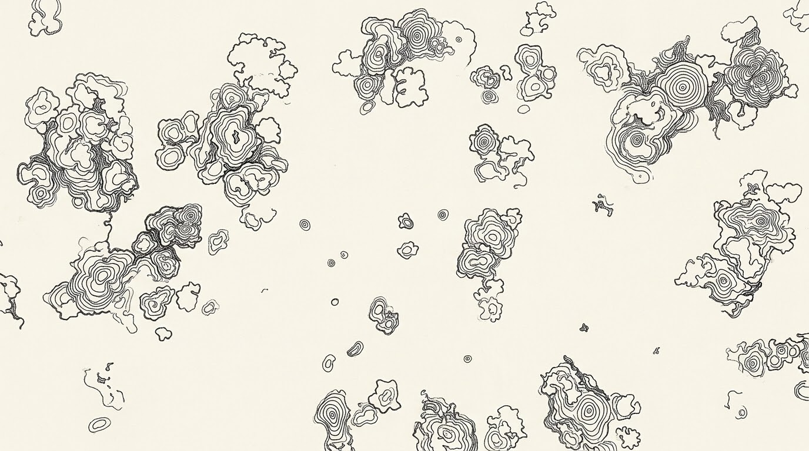
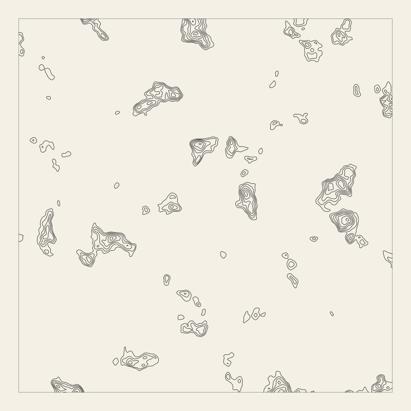
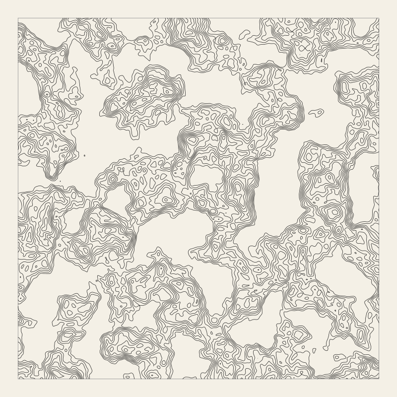
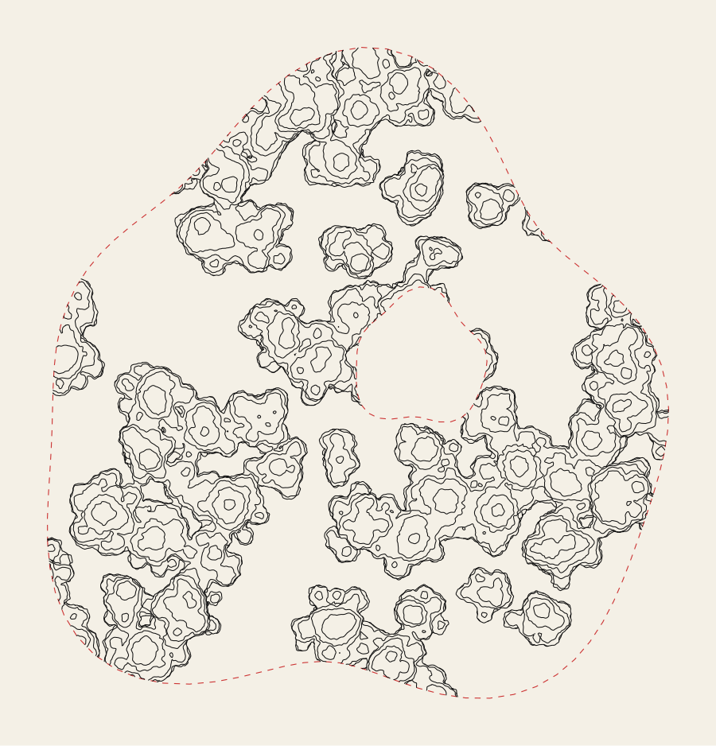
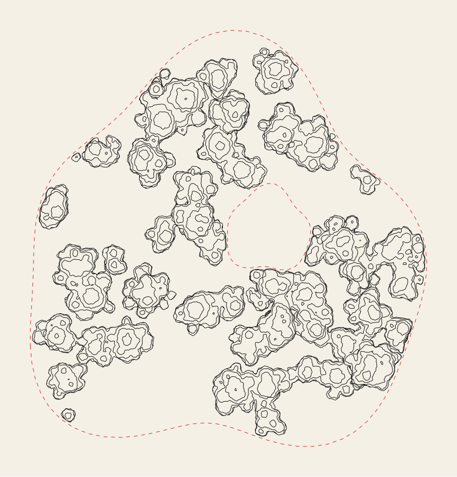
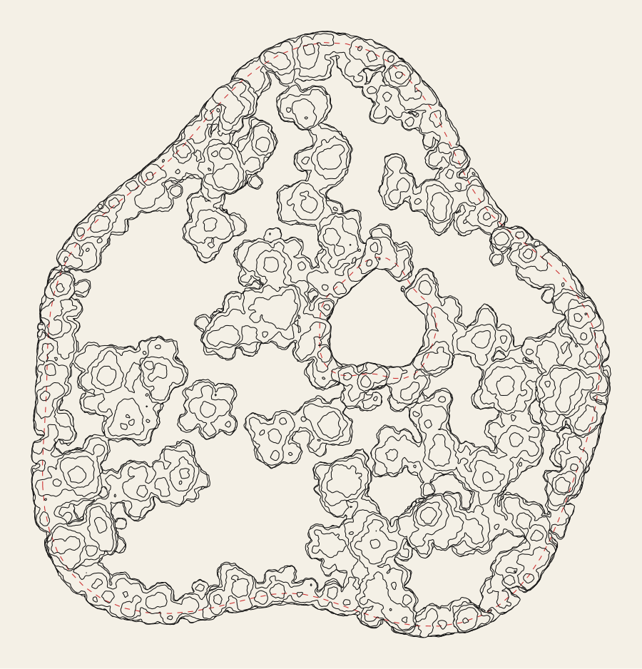
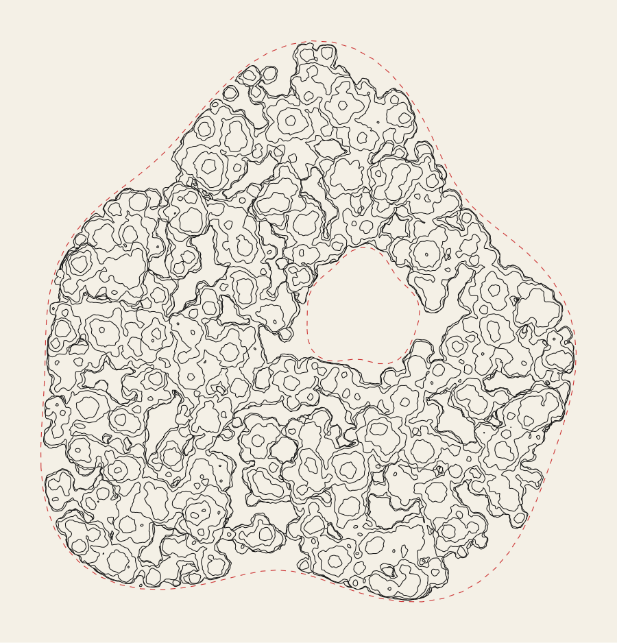

# Isoline blob fills (design)

**Status:** two generators. `isoline-blobs`: flat contours of one continuous 2D field. `isoline-stack`: 3D stacked slices with overhang and boundary modes (see below). Footprints reach compose masks through `fills.cover` (below).  
**Target look:** reference drawings (nested contour “cells” on paper; sparse scattered masses or dense all-over texture).  
**Split:** penfill generates **strokes + coverage polygons**; draw.land clips to the host area and applies **compose masks** to other layers.

This is **not** a symbolic tree icon, a regular hatch, or a single vein texture. The product is **many closed isolines per blob**, nested like height lines on a soft hill, with spacing that can read as light and shadow.

## Visual target (reference art)

**Files:** [`img/isoline-blob-fills/`](img/isoline-blob-fills/) — commit reference PNGs/JPEGs here; link them from this section.

### Scattered (primary reference)

| Reference | Generated (`fill_isoline_blobs_with_coverage`, defaults) |
| --- | --- |
|  |  |

Few separate organic clusters; empty paper between them. Each cluster is a stack of **closed** loops following one irregular silhouette; inner loops shrink toward a ridge or centre. Neighbouring clusters **fuse** into one lobed silhouette instead of stamping over each other — see "One field, not one blob per site" below.

### Dense (same field, lower threshold)



Same generator, lower `threshold` (more of the field counts as "ink"): clusters grow until they tile the region edge-to-edge and fuse into fewer, larger connected masses — no separate dense code path needed.

Two variants of the same language:

| Variant | Composition | Line work |
| --- | --- | --- |
| **Scattered** | Few to many separate organic clusters; lots of empty paper between them | Nested closed loops per blob |
| **Dense** | Edge-to-edge; overlapping masses | Same; spacing varies for shading |

Shared traits to reproduce in vector:

- **Isoline stacks:** each blob is a scalar field sliced at several levels; output is **contour lines**, not filled solids (except coverage — see below).
- **Organic silhouette:** amoeboid boundaries with controlled **wobble**, not CAD circles.
- **Density as shading:** contour spacing varies (light direction + local noise).
- **Layered overlap (dense mode):** draw order + optional mask, not SVG transparency.

Compare implementation output to these files, not to built-in gallery patterns.

## Stacked slices: `isoline-stack` (3D, overhang, boundary-aware)

The flat field (`isoline-blobs`) can only nest, so every ring sits inside the one below it and nothing ever overhangs. Vegetation needs upper layers that are wider than what's under them and hide it. `isoline-stack` builds each crown from spheres at different heights (they melt into one bubbly surface), cuts the volume into horizontal slices, and draws the top slice first. Each lower slice is drawn only where no higher slice covers it. Implementation notes: penfill [isoline-blob-fills.md](../../../penfill/docs/architecture/isoline-blob-fills.md).

| `edge: "clip"` | `edge: "inside"` | `edge: "overflow"` |
| --- | --- | --- |
|  |  |  |
| ignores the border; cut there | every outline closes inside the border; nothing cut | crowns line the border and bulge up to `overflow` mm past it, closing there |

`coverage: 1` (here with `edge: "inside"`):



Profile options (`spacing` = crown size):

| Option | Default | Meaning |
| --- | --- | --- |
| `edge` | `"clip"` | `clip`, `inside`, `overflow` |
| `overflow` | `spacing × 0.4` | how far past the border `overflow` may reach |
| `bubble` | `spacing × 0.3` | sphere size: smaller is lumpier |
| `coverage` | `0.6` | share of the area under canopy (0–1) |
| `slices` | `14` | horizontal cuts: more is more rings |
| `jitter` | `0.8` | outline wobble |

Fill output is not clipped again in `fill.rs`, so `overflow` ink reaches past the area as drawn.

## Problem

We need a fill that:

1. Lives inside a map polygon (forest, cloud bank, mist, lichen, etc.).
2. Emits **plotter linework** (the isoline stacks).
3. Emits **one or more polygons** describing the **occupied extent** of the blobs (for erasing dots, hatches, or terrain underneath via `compose.mask`).
4. Accepts **particle sites** either generated inside the region or supplied (e.g. real tree positions).

Today penfill returns only strokes; draw.land `$fills` are only `Lines`. Masking expects `$areas`.

## Concepts

| Term | Meaning |
| --- | --- |
| **Host region** | The map polygon (with holes) the fill is drawn in — park, cloud mask, etc. |
| **Field** | One scalar function `h(p)` over the whole host, sampled once. |
| **Cluster** | A connected component of `{ p : h(p) ≥ threshold }` — reads as one organic mass; may include several noise peaks that fused. |
| **Site** | Optional known position (real tree, placed cloud seed) that raises the field locally, instead of (or alongside) ambient noise. |
| **Strokes** | All isoline polylines, clipped to the host. |
| **Coverage** | Closed loops of the **lowest** (`threshold`) isoline only — the cluster silhouettes — used for occlusion, not every nested ring. |

**Coverage vs strokes:** masks follow the threshold contour's silhouette, not every interior ring, or a `compose.mask` would punch hairline slits instead of clean holes.

## Generation model (implemented)

### One field, not one blob per site

The first implementation built an **independent height field per site** (a dome around each point) and **unioned their outlines** for coverage. Visually this produced isolated stamped shapes that only ever *overlaid* each other at the edges — never read as one continuous mass, and didn't match the reference art's fused, amoeboid clusters.

The fix: build **one scalar field over the whole region** and slice it with many isolines in a single pass (`field::fill_isolines`, the same primitive `marble`/`wood` use, just with far more levels). Marching squares naturally **merges** contours wherever two nearby basins overlap above the threshold — exactly the cartographic contour-map behaviour ("two hills whose slopes meet become one ring at the saddle"). No explicit union step, no per-site clipping, no discrete "blob" objects at all: fusing is a property of slicing one field, not a step applied afterward.

```rust
h(p) = fbm(warp(p) / feature_size)        // ambient texture, roughly [-1, 1]
     + Σ sites: weight · exp(-|p - site|² / radius²)   // optional known positions
```

- `warp(p)` offsets `p` by a second, independent noise field before sampling — this is the "jitter": it bends the isolines' grid-aligned curvature into the hand-drawn wobble in the reference, without touching cluster placement.
- With no sites, clusters appear wherever the ambient noise happens to peak, spaced roughly `feature_size` mm apart (the **scattered** reference).
- `threshold` is the only density/connectivity knob: lower it and more of the field counts as "ink," so basins merge into fewer, larger connected masses (the **dense** reference) — same field, no second code path.
- `contour_spacing` sets the mm gap between consecutive rings; internally converted to a step in field units via the field's known slope (`≈ 1 / feature_size`).

### Custom sites instead of (or with) noise

`FieldSource`:

- `Noise` — pure procedural, as above.
- `Sites(Vec<FieldSite>)` — only the given positions raise the field; flat everywhere else. For real tree/feature positions where random placement would be wrong.
- `NoiseAndSites(Vec<FieldSite>)` — placed sites plus ambient texture, so known positions still read as the same organic material as a procedural patch.

Two sites close enough that their bumps overlap above `threshold` fuse into one silhouette automatically — this is covered by a unit test (`two_close_sites_fuse_into_one_loop`) precisely because it was the behaviour the first attempt got wrong.

### Light / shading (not yet implemented)

Not built in the MVP. The natural extension is biasing `threshold` (or `level_step`) by `dot(∇h, light_dir)` so contours crowd on one side — left as a follow-up once the base texture is approved.

## Penfill deliverable (implemented)

```rust
pub struct FillWithCoverage {
    pub strokes: Strokes,
    pub coverage: Region, // multipolygon + holes
}

pub enum FieldSource { Noise, Sites(Vec<FieldSite>), NoiseAndSites(Vec<FieldSite>) }

pub struct IsolineFieldParams {
    pub seed: u64,
    pub source: FieldSource,
    pub feature_size: f64,     // mm; ambient noise wavelength / cluster spacing
    pub contour_spacing: f64,  // mm between nested rings
    pub warp: f64,             // domain-warp strength (jitter)
    pub threshold: f64,        // field height where ink begins; lower = more fused/denser
}
```

`fill_isoline_blobs_with_coverage(region, &params) -> FillWithCoverage` in `penfill::isoline_blobs`. `coverage` comes from a second, single-level `fill_isolines` call at `threshold`, keeping only closed loops.

Streaming not yet implemented (whole-field sampling up front); candidate for later if a host area makes this fill's memory a concern.

## draw.land deliverable

| Responsibility | Owner |
| --- | --- |
| Host polygon, scale mm, stroke style | Profile + `grammar_run` |
| Resolve `particles.from` features → points | draw.land |
| Run penfill, get strokes + coverage | `fill.rs` fill pass |
| Clip strokes to host | penfill (invariant) |
| Punch holes in other groups | `compose.mask({ from: $areas.*, occludes })` |

### Coverage as an area (`fills.cover`)

`fills.cover(options)` (`library.js`) writes `tools_fill_cover` under `$areas` (`Op::FillCover` in `grammar.rs`, same body as `tools_fill` minus `per`/`content`). `grammar_run` evaluates it with `fill::cover`: the generator's footprint for `isoline-blobs` / `isoline-stack`, the area itself for every other pattern. Pass the **same options object** to `fills.fill` and `fills.cover`: `fill::covering` keeps the cover's run in a thread-local cache keyed by spec + region, and the fill pass takes it from there, so the pattern runs once.

```js
const FOLIAGE = { in: wood.visible, pattern: "isoline-stack", spacing: "4mm", edge: "inside", coverage: 0.8 }
draw({ id: "wood_foliage", from: fills.fill(FOLIAGE) })
compose.mask({ name: "foliage", from: fills.cover(FOLIAGE), occludes: ["wood_dots", "terrain"] })
```

Masking with the host area instead of the cover erases the ground in the clearings too. `web/src/presets/city-grain.js` does it this way: wood is dotted, and the foliage on top erases dots and burin only under the crowns.

## Phases

1. ~~Penfill prototype~~ — done: single-field isolines, visually matched against reference art (`example-generated.png`).
2. ~~Coverage~~ — done: threshold-isoline silhouettes; unit-tested for fuse/stay-separate behaviour and host containment.
3. ~~draw.land wire-up~~ — done: both patterns, and coverage as `$areas` via `fills.cover`.
4. **Particles from features** — `FieldSource::Sites`/`NoiseAndSites` exist in penfill; draw.land does not yet resolve `$features` centroids into them.
5. **Light bias** — not implemented. In the stacked model this is natural: shift each slice's outline by a light direction, or drop rings on the lit side.
5b. ~~Overhang and boundary modes~~ — done: `isoline-stack`.
6. **Streaming + budget** — not implemented; whole-field sampling today.

## Tests

- Visual regression against reference (checked in gallery or committed small fixture).
- Deterministic seed.
- Mask integration: lines under coverage removed from occluded group only.

## Related docs

- [fills-compose.md](fills-compose.md) — masks and fill pipeline.
- penfill: [isoline-blob-fills.md](../../../penfill/docs/architecture/isoline-blob-fills.md) — implementation notes (`field`, `Region`).

## Decisions (when built)

Record in [decisions.md](decisions.md): fills may publish **coverage** areas for compose; isoline blob pattern is the reference aesthetic above, not a reuse of symbolic nature icons.
