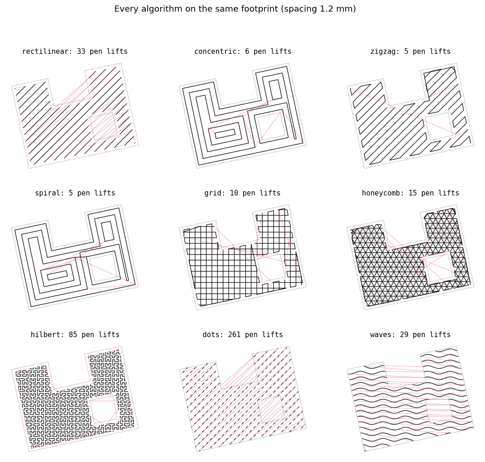
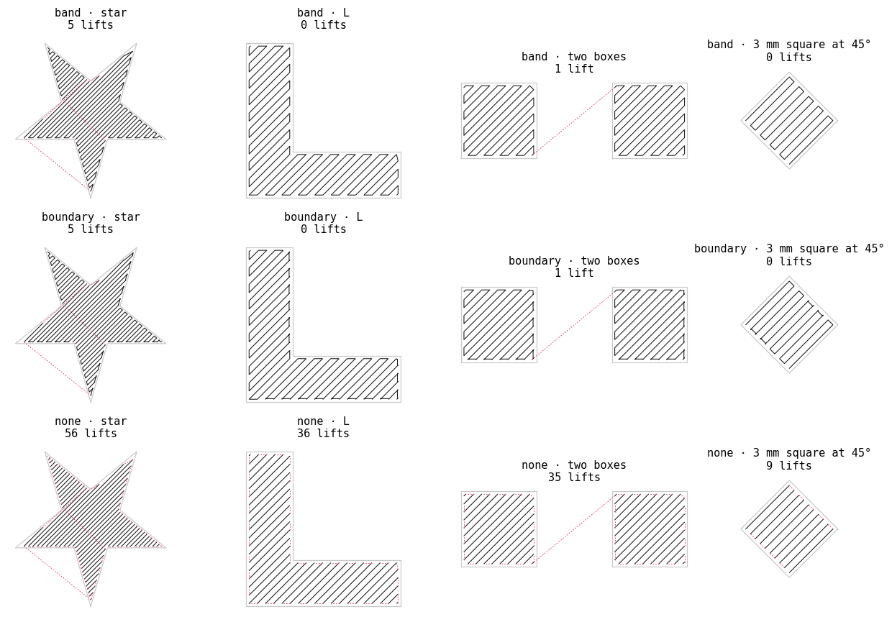
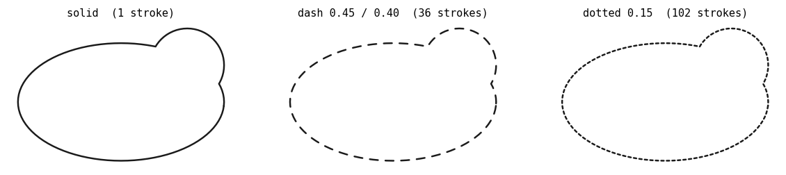

# Fills & strokes: theme styling in the plot profile

Themes still decide **what** geometry exists (parks from OSM tags, buildings
from footprints, …). The profile decides **how** that geometry is drawn:
which fill algorithm, spacing, angle, and whether outlines are solid, dashed,
or dotted.

## Area fills

Algorithms live under `postcards/utils/fills/`. Selection is per theme:

```toml
[fill.buildings]
algorithm = "zigzag"
spacing = "0.5mm"
angle = 45

[fill.water]
algorithm = "waves"
spacing = "0.75mm"
angle = 0

[fill.parks]
algorithm = "dots"
angle = 45
mark = "0.2mm"
spacing = "0.50mm"
leftover = "wood"

# Each kind can pick its own algorithm — not just a denser/sparser dots grid.
[fill.parks.kinds.garden]
algorithm = "dots"
spacing = "0.25mm"

[fill.parks.kinds.park]
spacing = "0.45mm"

[fill.parks.kinds.wood]
algorithm = "waves"
spacing = "0.70mm"
angle = 0

[fill.parks.kinds.grass]
algorithm = "rectilinear"
spacing = "0.85mm"
angle = 30
```

Shorthand still works when you only want to change spacing:

```toml
[fill.parks.kinds]
garden = "0.25mm"
wood = "0.70mm"
```

Any theme can use any algorithm — put `algorithm = "waves"` under buildings
tomorrow if you want buildings to look like water. Omit a theme's section to
keep that filter's code defaults (buildings fall back to the historical
card-wide hatch).

### Algorithms

| Name | What it draws | Continuous? |
|---|---|---|
| `rectilinear` | Parallel hatch (baseline / legacy look) | no — one stroke per fragment |
| `zigzag` | Same hatch, ends joined into a serpentine | yes |
| `spiral` | Concentric rings joined outside-in | mostly |
| `concentric` | Concentric rings, unjoined | each ring is one stroke |
| `grid` | Two `zigzag` passes at 90° | yes (per direction) |
| `honeycomb` | Three `zigzag` passes at 60° | yes (per direction) |
| `hilbert` | Hilbert curve clipped to the region | broken by the clip |
| `dots` | Short-mark stipple grid | no — one dab per cell |
| `waves` | Sine-wave hatch (historical water) | yes — one stroke per band |

A `dots` mark shorter than its grid step (the parks configuration: `mark =
"0.2mm"` at 0.25–0.85 mm spacing) is laid out vectorised and only the dabs
that straddle a boundary are clipped; a mark at or above the step takes the
generic clip path, which is slower on large regions.



Dashed pink is pen-up travel between consecutive strokes, in the order the fill
returns them (before vpype's `linesort`). Regenerate with
`python docs/make_figures.py`.

`grid` and `honeycomb` are **not** loose cross-hatches. Each direction is a
full zigzag traversal so the pen does not rely on `linesort` to stitch
neighbours — that would risk connectors outside the footprint.

Optional per-algorithm options:

```toml
[fill.buildings.zigzag]
connector = "band"      # band | boundary | none
```

`band` (default) tries a straight hop between facing scan-line ends; when the
outline is irregular and that hop would leave the footprint, it follows the
inset perimeter instead. `boundary` prefers the perimeter path. `none` only
reorders fragments.



The lift between the two boxes is deliberate: separate parts are never
bridged.

### Contract

```python
def fill_<name>(region, spacing, **options) -> list[LineString]
```

- `region` is already in page millimetres (Polygon or MultiPolygon)
- strokes stay inside the region; continuous fills inset by ~`spacing / 2`
  (unless `inset` is set in the profile)
- holes are respected — nothing crosses a courtyard
- MultiPolygons are filled per part; no bridge between buildings

## Outline strokes

```toml
[stroke.parks]
style = "dash"          # solid | dash | dotted
dash = "0.45mm"
gap = "0.40mm"

[stroke.water]
style = "solid"
```

Dashes are real geometry (short LineStrings), not SVG `stroke-dasharray` —
vpype → G-code would otherwise ignore the pattern.



## Measuring / comparing

```bash
# fixture shapes (L, ring, star, U, …)
python -m postcards fills --shape L --output-dir /tmp/fills

# real footprints from an existing map.svg
python -m postcards fills \
  --from-svg exports/500_folsom_street_san_francisco_ca/map.svg \
  --output-dir /tmp/fills_real
```

Prints lifts, drawn length, coverage and containment for every algorithm, and
writes one SVG each.

## Layout

```
postcards/utils/fills/
├── __init__.py        # registry: name → callable
├── _common.py         # inset, sweep, clip helpers
├── dots.py            # dots + waves (pattern-style fills)
├── rectilinear.py
├── zigzag.py
├── …
postcards/utils/theme_style.py   # reads [fill.*] / [stroke.*] for filters
docs/make_figures.py             # renders docs/img/*.png
```

## Still open

- **Roads centre-line dash** still lives in `filters/roads.py`; could move under
  `[stroke.roads]` later.
- **Skeleton / Fermat.** Worth it only if zigzag + spiral leave a measurable
  gap on real footprints.
- **Spiral on messy MultiPolygons.** Treat as experimental until containment
  misses are closed.
